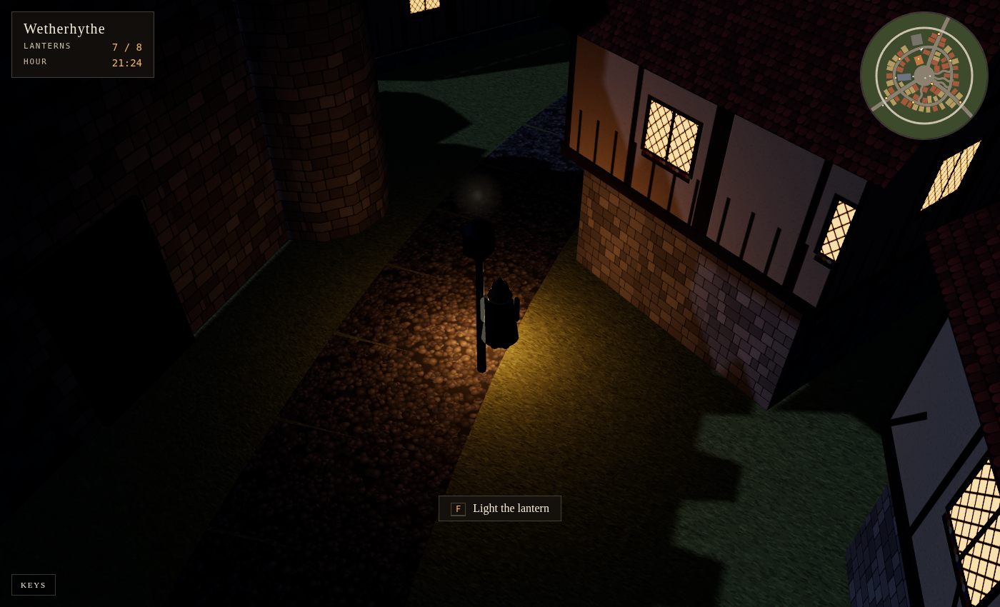

# Lanternfall

It is the eve of the Lantern Fair, and every lamp in town has gone dark. Walk
the streets of a walled medieval town, ask the townsfolk, and light every
lantern before midnight. Each town is built from its name, and no two are
alike. It runs in the browser on three.js.

It is also a tour of [`toft`](https://github.com/larchway-labs/toft-cli), the
command line for [Toft](https://gettoft.com), which builds, runs and serves
apps like this one. Run these in order from a Linux terminal.

1. `curl -fsSL https://raw.githubusercontent.com/larchway-labs/toft-cli/main/install.sh | sh` installs `toft`, a single binary.
2. `git clone https://github.com/larchway-labs/lanternfall && cd lanternfall` gets the game.
3. `toft login https://trytoft.dev` signs you in to the public playground. A browser opens once.
4. `toft check` shows what Toft makes of the folder: a Flask app, its Python version, two jobs and their limits.
5. `toft create --app lanternfall-$USER --link --logs` names the app, asks once, then deploys it with a live build tree and the build log streaming beneath it.
6. `toft status` says what's serving and where. Open that URL and play.
7. `toft job list` lists the game's two jobs, their parameters, and when the scheduled one runs next.
8. `toft job run found --param name="Ravenby" --param season=winter --follow` founds a snowy town, with a live progress line through every street and house.
9. `toft job run found` leaves out the required name, so `toft` asks you for it.
10. `toft job runs` shows the run history: who started each run, how long it took, and how it ended.
11. `toft job run town-of-the-day --for 2027-01-01` founds the town for a date you choose.
12. `toft env set REALM="In the Kingdom of Elsewhere" --restart` renames the realm. Reload the title screen to see it.
13. `toft logs -f` follows the game live. Play a round and watch each lantern you light arrive.
14. `toft top` shows a live board of your apps and this one's job runs. Press `q` to leave.
15. `toft deploy` ships your working copy again. Change a season's colours in `static/textures.js` first and watch them arrive.
16. `toft rollback` names the release it's going back to, asks, then rolls back.
17. `toft events` shows what the platform noticed about the app.
18. `cd ~ && toft logs` runs outside the game's folder, so `toft` asks you to pick an app.
19. `toft status --json | jq .` shows the JSON every command gives a script.
20. `toft delete lanternfall-$USER` removes it all, once you type the name.
