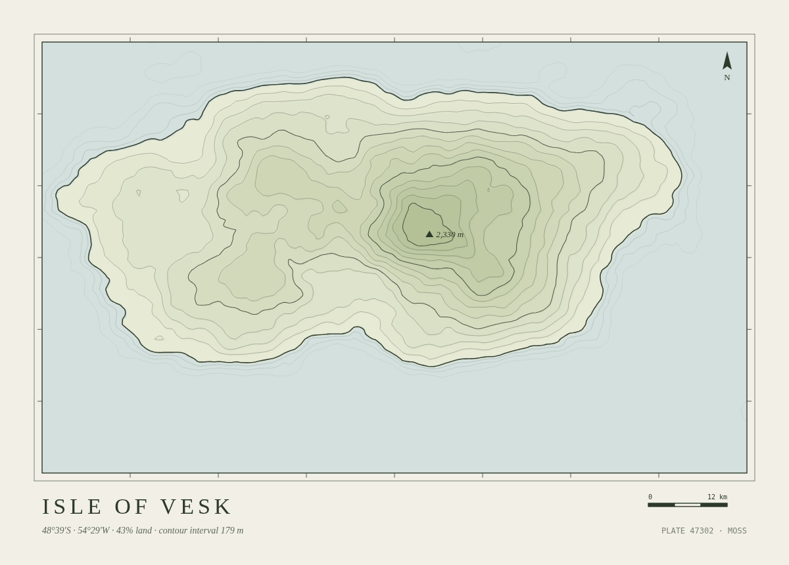

# Contour Atlas

Topographic plates of islands that do not exist. Name an island, and it is
surveyed, contoured and printed as a plate; the same name always gives the same
island.

It is also a tour of [`toft`](https://github.com/larchway-labs/toft-cli), the
command line for [Toft](https://gettoft.com), which builds, runs and serves
apps like this one. Run these in order from a Linux terminal.

1. `curl -fsSL https://raw.githubusercontent.com/larchway-labs/toft-cli/main/install.sh | sh` installs `toft`, a single binary.
2. `git clone https://github.com/larchway-labs/contour-atlas && cd contour-atlas` gets this app.
3. `toft login https://trytoft.dev` signs you in to the public playground. A browser opens once.
4. `toft check` shows what Toft makes of the folder: a Flask app, its Python version, two jobs and their limits.
5. `toft create --app atlas-$USER --link --logs` names the app, asks once, then deploys it with a live build tree and the build log streaming beneath it.
6. `toft status` says what's serving and where. Open that URL in a browser.
7. `toft job list` lists the app's two jobs, their parameters, and when the scheduled one runs next.
8. `toft job run render --param name="Isle of Vesk" --param palette=moss --follow` surveys an island while a live progress line works through each contour.
9. `toft job run render` leaves out the required name, so `toft` asks you for it.
10. `toft job runs` shows the run history: who started each run, how long it took, and how it ended.
11. `toft job run plate-of-day --for 2027-01-01` draws the plate for a date you choose.
12. `toft env set ATLAS_TITLE="Atlas of Elsewhere" --restart` renames the atlas. Reload the page to see it.
13. `toft logs -f` follows the app's log live. Click around the atlas and watch each request arrive.
14. `toft top` shows a live board of your apps and this one's job runs. Press `q` to leave.
15. `toft deploy` ships your working copy again. Change a colour in `terrain.py` first and watch it arrive.
16. `toft rollback` names the release it's going back to, asks, then rolls back.
17. `toft events` shows what the platform noticed about the app.
18. `cd ~ && toft logs` runs outside the app's folder, so `toft` asks you to pick an app.
19. `toft status --json | jq .` shows the JSON every command gives a script.
20. `toft delete atlas-$USER` removes it all, once you type the name.
